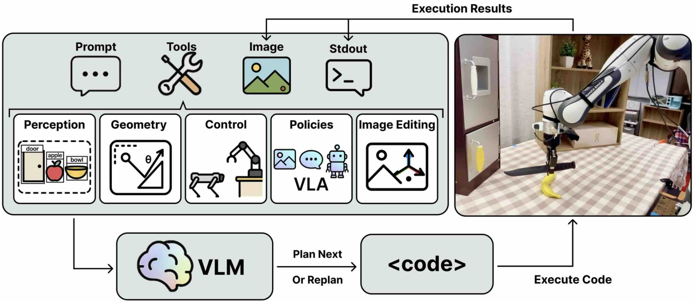

<h1 align="center">MAESTRO</h1>
<p align="center">
  <b>Orchestrating Robotics Modules with Coding Agents for Zero-Shot Generalist Robots</b><br>
  <a href="https://maestro-robot.github.io/">Project page</a> ·
  <a href="https://openreview.net/forum?id=BxW31Dilgn">Paper</a> ·
  <a href="docs/SETUP_WORKSTATION.md">Install</a> ·
  <a href="docs/TOOLS.md">Robot tools</a>
</p>

Maestro lets a vision-language model (VLM) control a robot arm by writing code. You give it an
instruction such as *"put the red block in the bowl"*. The VLM looks at the scene, plans the
steps and writes code that integrates perception, spatial reasoning, control and image editing
tools. Maestro runs the code and feeds the execution results back to the VLM: a camera image
with the results drawn on it, the program's printed output and the robot state. The VLM judges
whether the step worked, then writes the next step or replans. This closed loop continues until
the task is done. No robot demonstrations or training are needed.

This repository is the system used on the Franka tabletop setup in the paper: a Franka arm on
the [DROID](https://github.com/droid-dataset/droid) platform with ZED stereo cameras.

## How it works

<p align="center">
  
</p>

Given the prompt and images, the VLM plans by writing and executing code that calls the tools.
The execution results (images and printed output) come back as feedback for reacting and
replanning, forming a closed loop. In this repository the tools are:

- **Perception.** The robot first scans the workspace with its wrist camera. The VLM can point
  at objects across all scan views at once (`locate_objects`), use open-vocabulary segmentation
  (Grounded-SAM) for a quick object centre (`locate_object_by_segmentation`), or pick precise
  points on an object part with a separate VLM agent (`locate_object_part`). 3D positions come
  from the wrist ZED's depth; FoundationStereo computes the cleaner scan depth that the
  collision map is built from.
- **Geometry (spatial reasoning).** Exact helpers (vectors, distances, relative rotations, frame
  conversions) so the VLM computes poses instead of guessing them.
- **Control.** `propose_grasps` looks at the object from a few angles, fuses the views into a
  point cloud and asks GraspGen for 6-DoF grasps. `move_to_pose` and `execute_grasp` plan
  collision-free paths with cuRobo around a 3D map built from the scan; `open_gripper`,
  `close_gripper` and `reset` complete the set.
- **Image editing.** The VLM draws points and poses on the next image it sees, so it can check
  results it could not judge from numbers alone.

The paper's tool library also includes learned visuomotor policies (VLAs) as optional tools;
they are not part of this release yet.

The full list of tools is in [docs/TOOLS.md](docs/TOOLS.md), and the system design in
[docs/ARCHITECTURE.md](docs/ARCHITECTURE.md).

## What you need

- A Franka FR3 or Panda arm on the DROID setup (the arm is driven through DROID's robot
  server), a Robotiq 2F-85 gripper, one ZED wrist camera and two external ZED cameras. See
  [docs/HARDWARE.md](docs/HARDWARE.md).
- A workstation for the robot (Ubuntu 22.04, ZED SDK).
- One or more NVIDIA GPUs for the GPU-backed tools (FoundationStereo, Grounded-SAM, GraspGen and
  cuRobo). They run as Docker services and can all share one machine, or be split across
  machines. We run two on the workstation's 16 GB GPU and two on a server.
- An API key for Gemini and/or OpenAI.

## Quick start

**1. Start the GPU services** on the machine(s) with NVIDIA GPUs (details in
[docs/SETUP_SERVICES.md](docs/SETUP_SERVICES.md)):

```bash
git clone https://github.com/Beethoven-Q/maestro.git && cd maestro
docker compose up -d --build      # or name the services to run on this machine
```

**2. Install the client** on the robot workstation (details in
[docs/SETUP_WORKSTATION.md](docs/SETUP_WORKSTATION.md)):

```bash
git clone https://github.com/Beethoven-Q/maestro.git && cd maestro   # skip if already cloned here
uv sync                                                     # Python environment, no GPU needed
uv run python /usr/local/zed/get_python_api.py              # download the ZED Python wheel (ignore its pip error)
uv pip install --python .venv pyzed-*.whl
cp .env.example .env                                        # add your API key(s)
cp config/maestro.example.yaml config/maestro.yaml          # cameras, robot, service addresses
```

**3. Run a task:**

```bash
uv run python -m maestro.runner -i "put the red block in the bowl"
```

The robot moves to its start pose, scans the table, and starts working. Watch the console for
the plans and tool output, and open `http://<graspgen-host>:7000/static/` to see proposed grasps
in 3D. When a trial ends you can type another instruction or press Enter to quit.

## What a run produces

Everything is saved under `runs/` (set by `paths.data_dir`):

| Folder | Contents |
|---|---|
| `runs/logs_all_tasks/<time>_<task>/` | `log.txt` (every plan, program and output), `timestamps.log` (all tool calls), the image the VLM saw after each step, `video.mp4` from an external camera, and a DROID-format trajectory under `recordings/` |
| `runs/grasp_data/<time>_<task>/` | perception data: scan images and depth, segmentation results and overlays, object point clouds, and grasp inputs. `latest_data/` holds the newest version of each file and `visualization/` a timestamped copy of every version |

Earlier trials can be given back to the planner to learn from with `-l runs/logs_all_tasks`.

## Choosing the VLM

`vlm.provider` in `config/maestro.yaml` switches every VLM role at once:

- `gemini`: Gemini 2.5 Pro plans, Gemini 3.1 Flash Image points at objects, and OpenAI o3
  picks points on object parts.
- `astra`: GPT-6 Astra does all three.

## Documentation

- [docs/SETUP_WORKSTATION.md](docs/SETUP_WORKSTATION.md): install the client on the robot workstation
- [docs/SETUP_SERVICES.md](docs/SETUP_SERVICES.md): build and start the GPU services
- [docs/CONFIGURATION.md](docs/CONFIGURATION.md): every setting in `.env` and `config/maestro.yaml`
- [docs/HARDWARE.md](docs/HARDWARE.md): robot, cameras, calibration
- [docs/TOOLS.md](docs/TOOLS.md): the tools the VLM can call
- [docs/ARCHITECTURE.md](docs/ARCHITECTURE.md): how the pieces fit together
- [docs/TROUBLESHOOTING.md](docs/TROUBLESHOOTING.md): common problems

## Citation

```bibtex
@inproceedings{shi2026maestro,
  title={{MAESTRO}: Orchestrating Robotics Modules with Coding Agents for Zero-Shot Generalist Robots},
  author={Shi, Junyao and Yang, Rujia and Chao, Kaitian and Wan, Selina Bingqing and Shao, Yifei and Lei, Jiahui and Qian, Jianing and Le, Long and Chaudhari, Pratik and Daniilidis, Kostas and Wen, Chuan and Jayaraman, Dinesh},
  booktitle={Conference on Robot Learning (CoRL)},
  year={2026},
  url={https://openreview.net/forum?id=BxW31Dilgn}
}
```

## Acknowledgements

Maestro builds on [DROID](https://github.com/droid-dataset/droid),
[cuRobo](https://github.com/NVlabs/curobo) and [nvblox](https://github.com/valtsblukis/nvblox),
[GraspGen](https://github.com/NVlabs/GraspGen),
[Grounded-Segment-Anything](https://github.com/IDEA-Research/Grounded-Segment-Anything),
and [FoundationStereo](https://github.com/NVlabs/FoundationStereo). See [NOTICE](NOTICE) for
their licenses; some model weights are for non-commercial use only.

## License

Maestro's own code is released under the [MIT License](LICENSE). The projects it builds on keep
their own licenses; see [NOTICE](NOTICE).
