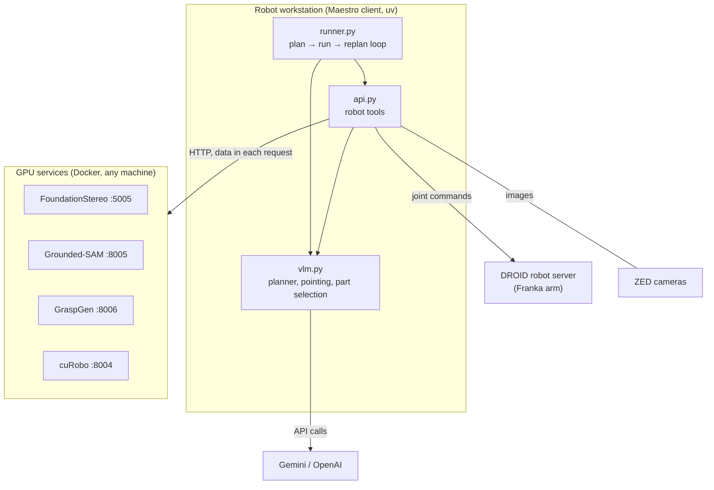

# How Maestro fits together

## The parts

- **Client** (`maestro/`, installed with `uv`, no GPU needed): the planning loop, the robot
  tools and the VLM calls. It talks to the arm through DROID's robot server and reads the ZED
  cameras directly.
- **GPU services** (`servers/`, Docker): the four GPU-heavy models behind small HTTP servers.
  Every request carries its inputs (images, depth, point clouds) and every response returns the
  results, so the services keep no files and can run on any machine the client can reach. Each
  one is a `host:port` in `config/maestro.yaml`. The other tools (geometry, image editing, the
  ZED depth, VLM pointing and part selection) run in the client or as cloud API calls.
- **Cloud VLMs**: the planner, object pointing and part-point selection; `vlm.provider`
  chooses Gemini or GPT-6 Astra for all of them.

## One trial

1. **Start.** The arm moves to its start pose and the wrist camera scans the table from 8
   viewpoints. FoundationStereo computes depth for each view while the arm moves on.
2. **Plan.** The VLM receives the system prompt (tool descriptions, coordinate conventions,
   strategy), the instruction, the robot state and an image. It describes the scene, plans
   the steps and writes code for the first step.
3. **Run.** The code runs with `robot` and `image_editor` available. Everything it prints is
   shown live and also captured for the VLM.
4. **Check and replan.** The VLM gets the printed output, the robot state and a new image with
   any points or poses drawn on it. It decides whether the step succeeded, and writes the next
   step's code, a fix, or reports the task complete.
5. Steps repeat until the task is complete or 20 attempts are used.

### Inside one grasp

1. `propose_grasps("red cup")` moves the wrist camera to the scan view that sees the cup best
   and confirms it is still there (Grounded-SAM).
2. The camera looks at the cup from up to three directions. In each view Grounded-SAM masks the
   cup, and the masked depth becomes points in the world frame. The views are merged into one
   point cloud.
3. GraspGen proposes grasps on that cloud; its 3D viewer shows them.
4. `execute_grasp(...)` sends the scan's depth images to cuRobo, which builds a 3D occupancy map
   of the scene, then plans a collision-free approach to the best reachable grasp. The arm
   follows the plan and closes the gripper.

## Service interfaces

Arrays travel as `.npy` (one array) or `.npz` (several) files in multipart requests.

| Service | Endpoint | Input | Output |
|---|---|---|---|
| FoundationStereo | `POST /depth` | left and right PNG images, focal length `fx`, `baseline` (m) | depth map (m), `.npy` |
| Grounded-SAM | `POST /segment` | PNG image, text `prompt` | `.npz`: `masks`, `boxes` (pixels), `scores`, `labels` |
| GraspGen | `POST /grasps` | `.npz`: object `points` (world frame) and `colors` | `.npz`: `grasps` (4×4 poses), `scores` |
| cuRobo | `POST /fuse_observation` | `.npz`: `depths`, camera `intrinsics`, camera-to-world `camera_poses` | `{success, views}` |
| cuRobo | `POST /plan` | JSON: `goal_pose` (4×4 flange pose), `start_state` (7 joints) | JSON: `success`, `trajectory`, `dt` |
| cuRobo | `POST /plan_grasp` | JSON: several `goal_pose`s, `start_state` | JSON: `success`, `trajectory`, `dt` |
| cuRobo | `POST /clean_map`, `POST /toggle_collision_for_grasp?flag=` | | `{success}` |

FoundationStereo and GraspGen also answer `GET /health`; Grounded-SAM serves its API page at
`/docs`.

## Code map

| Path | Contents |
|---|---|
| `maestro/runner.py` | the plan → run → replan loop, trial logging, video and trajectory recording |
| `maestro/api.py` | the robot tools (`RealFrankaRobotApi`) and the feedback image editor (`ImageEditApi`) |
| `maestro/vlm.py` | the planner chat, multi-view pointing and part-point selection for Gemini and Astra |
| `maestro/perception_utils.py` | clients for the four services, and helpers for their results |
| `maestro/prompts/maestro_prompt.txt` | the planner's system prompt: tools, conventions, strategy, examples |
| `maestro/config.py` | loads `config/maestro.yaml` and `.env` |
| `maestro/trajectory_recorder.py` | writes DROID-format trajectories |
| `droid/` | the parts of DROID Maestro uses: robot server client, cameras, calibration |
| `servers/<service>/` | each service's server, Dockerfile, pinned requirements and README |
| `compose.yaml` | starts the four services |
| `scripts/check_camera_depth.py` | tests a ZED camera and the depth service without the robot |
| `tests/` | unit tests (`uv run python -m unittest discover -s tests`) |

## Saved data

See [What a run produces](../README.md#what-a-run-produces). Inside
`runs/grasp_data/<trial>/latest_data/`:

| File | Written by |
|---|---|
| `scan_cache/pose_<n>_{left,right}.png`, `pose_<n>_depth.npy`, `meta.json` | the workspace scan (images, depth, camera pose and intrinsics per view) |
| `rgb_3.png`, `mask.json`, `masks.npy`, `segmentation_3.jpg` | the latest segmentation (input, detections, masks, overlay) |
| `look_around_images/` | the views taken for a grasp |
| `pcd.json` | the object point cloud sent to GraspGen |
| `crop_img_annotated.png` | the numbered points shown to the part-selection VLM |
| `wrist_points_view<n>.png`, `wrist_points_world.json` | points found by `locate_objects` |
| `rgb_1.png`, `right_rgb_1.png`, `depth_1.npy` | the single view used for collision checking before the first scan |
